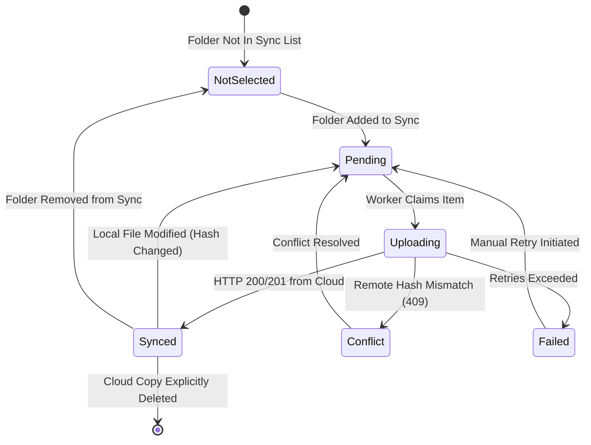

# System Architecture – File Archaeologist

## 1. Executive Architectural Summary

File Archaeologist provides semantic and fuzzy memory-based document discovery across local and cloud environments. It was engineered under four non-negotiable architectural mandates:

1. **Independent Search**: Desktop search queries only local indexed files; Cloud search queries only cloud indexed files. Search spaces are never automatically aggregated or merged.
2. **Optional & User-Controlled Synchronization**: Synchronization is opt-in, folder-specific, and non-destructive. Local documents are always primary and are never deleted or modified during sync.
3. **True Local-First Resilience**: The Desktop Edition works 100% offline without requiring internet access or third-party cloud API availability.
4. **No Simulated Functionality**: Every endpoint reports authentic system diagnostics; services in degraded states fail safely and report genuine status rather than mock success.

---

## 2. Dual Platform Topology

```mermaid
flowchart TD
    subgraph Client["Presentation Tier (Shared)"]
        SPA["React 18 + TypeScript + Vite SPA\nSpotlight Search • Dark Violet Theme"]
    end

    subgraph DesktopTier["Desktop Edition (Local Machine)"]
        FastAPI["FastAPI App (127.0.0.1:8420)"]
        MySQL["MySQL 8.0 Storage Engine\n(InnoDB, Stored Procedures, Transactions)"]
        HNSW["HNSW Vector Engine (384-dim)\nvectors.hnsw + vectors_metadata.json + manifest"]
        Embedder["SentenceTransformers / SBERT\n(Sliding-Window Chunking & Pooling)"]
        Watcher["Watchdog Filesystem Monitor\n(Recursive Event Debouncing)"]
        Extractors["Multi-Format Extractors\n(PDF, DOCX, Legacy DOC, HTML, Text, OCR)"]
        LocalSync["SyncService (SQLite sync.db)\nSHA-256 Hasher & Transfer Queue"]
    end

    subgraph CloudTier["Cloud Edition (Cloudflare Edge Stack)"]
        Worker["Cloudflare Worker API Gateway"]
        D1["Cloudflare D1 Database (SQLite at Edge)"]
        R2["Cloudflare R2 Object Store (Document Blobs)"]
        Queue["Cloudflare Queues (Background Indexing)"]
        Vectorize["Cloudflare Vectorize Index (Cosine, 384-dim)"]
    end

    SPA -->|Desktop Mode| FastAPI
    SPA -->|Cloud Mode| Worker

    FastAPI --> MySQL
    FastAPI --> HNSW
    FastAPI --> Embedder
    FastAPI --> Watcher
    FastAPI --> Extractors
    FastAPI --> LocalSync

    LocalSync -.->|Optional Uploads (/api/upload)| Worker

    Worker --> D1
    Worker --> R2
    Worker --> Queue
    Worker --> Vectorize
```

---

## 3. Desktop Subsystem Details

### 3.1 Metadata Storage (MySQL 8.0)
- **Engine**: InnoDB with strict foreign keys (`ON DELETE CASCADE` from folders to files).
- **Concurrency**: Worker uses `sp_fetch_pending_files` wrapped in atomic transaction boundaries (`START TRANSACTION ... COMMIT`) with `SELECT ... FOR UPDATE SKIP LOCKED` to allow multiple concurrent worker threads without locking contention.
- **Audit Logging**: `operation_logs` and `failed_extractions` record all indexing operations, scan failures, and system events.

### 3.2 Vector Index & Manifest Management
- **Persistence Decoupling**: Vector embeddings are written to native binary `vectors.hnsw`, and metadata mappings are written to `vectors_metadata.json`.
- **Integrity Manifest**: `index_manifest.json` tracks index version (`2.0.0`), embedding model identifier (`all-MiniLM-L6-v2`), dimensions (`384`), total vector count, generation UUID, and SHA-256 checksums.
- **Atomic Operations**: All saves use temporary files (`.tmp`) followed by atomic OS replace operations to protect against unexpected process termination.
- **Automated Backups & Compaction**: Rolling backups are kept under `data/vector_index/backups/`. Soft-deleted vectors trigger index compaction when the deleted vector ratio exceeds 20%.

### 3.3 Embedding & Long Document Chunking
- **Chunking Pipeline**: Documents of arbitrary length are processed via a sliding-window chunker (1,500 characters per chunk, 250 character overlap, up to 20 chunks).
- **Mean Pooling & L2 Normalization**: Chunks are embedded individually and pooled via dimension-wise averaging followed by L2 unit normalization, ensuring full-document discoverability without arbitrary truncation.
- **Fallback Resilience**: When PyTorch/SentenceTransformers are unavailable, a deterministic local subword tokenizer provides embedding continuity.

### 3.4 Filesystem Scanner & Watcher Reliability
- **Scan States**: Scans transition through `PENDING -> RUNNING -> COMPLETED` (or `PARTIAL`, `FAILED`, `CANCELLED`).
- **Safe Deletion Reconciliation**: Deletion reconciliation ONLY executes upon verified `COMPLETED` scans. If a scan is interrupted or cancelled, no files are removed from the database.
- **Event Debouncing**: Filesystem creation, modification, and deletion events from Watchdog pass through `FileLifecycleService` to prevent redundant worker processing during active writes.

---

## 4. Cloudflare Edge Architecture

### 4.1 Multi-Tenant Edge Gateway
- **Runtime**: Cloudflare Workers with Node.js compatibility (`nodejs_compat`).
- **Security**: Workspace-level authorization via `Authorization: Bearer <token>` or `X-API-Key`.
- **Storage**: Binary documents uploaded via `/api/upload` are assigned deterministic R2 object keys (`workspaces/{workspace_id}/files/{file_id}/{filename}`) and stored in Cloudflare R2.
- **Relational Metadata**: Multi-tenant D1 database tracks users, workspaces, monitored sources, file records, search history, and synchronization manifests.
- **Asynchronous Ingestion**: Heavy document processing is dispatched through Cloudflare Queues (`file-indexing-queue`) to prevent request timeouts.

---

## 5. Synchronization Subsystem

### 5.1 Non-Destructive Principles
- **Local Primary**: Local files are never deleted, renamed, or modified by the synchronization engine.
- **Folder Selective**: Users explicitly select individual folders. Attempting to synchronize root drives (`/` or `C:\`) or OS system directories is blocked by server-side security checks.
- **Change Detection**: Local files are hashed via SHA-256. Only files with changed hashes are queued for upload.
- **Independent Document IDs**: Synchronized documents receive independent cloud identifiers. Deleting a local folder simply unbinds sync tracking; cloud copies remain intact unless explicitly deleted via the user-initiated `DELETE /api/sync/cloud-copy` action.

### 5.2 State Machine



