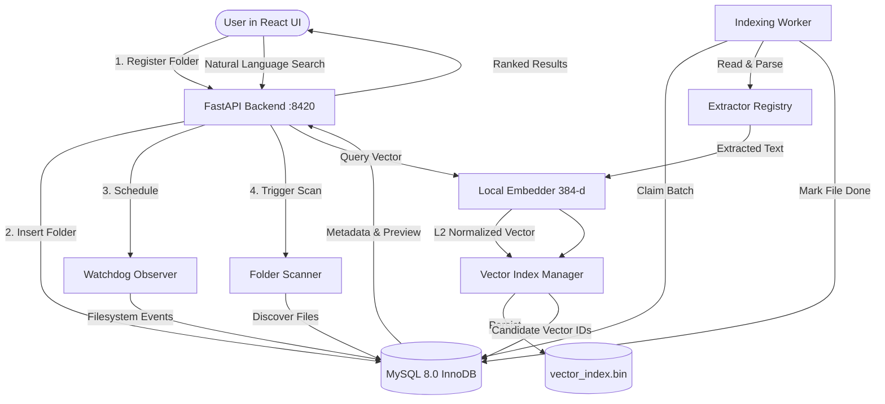

# Architecture & Data Flow

## 1. High-Level Data Flow

## 2. Component Boundaries
- **FastAPI Layer (`backend/app/routes/`)**: Exposes REST endpoints, validates inputs with Pydantic, translates HTTP errors into sanitized client responses.
- **Metadata Store (`backend/app/core/metadata_store.py`)**: Central repository encapsulation for all 14 MySQL stored procedures and parameterized SQL queries.
- **Worker (`backend/app/core/worker.py`)**: Background thread managing bounded batch claims (`sp_fetch_pending_files`), file stability checks, extraction, embedding, vector update, and MySQL status commitment.
- **Watcher (`backend/app/core/watcher.py`)**: Debounced filesystem event monitoring capturing creation, modification, move, and deletion.
- **Vector Index (`backend/app/core/vector_index.py`)**: HNSWlib / NumPy vector engine operating in Cosine space with persistent atomic file backup.
- **Frontend SPA (`frontend/src/`)**: Desktop-optimized React interface with Spotlight search bar, real-time live indexing dashboard, search history insights, and settings dialog.
